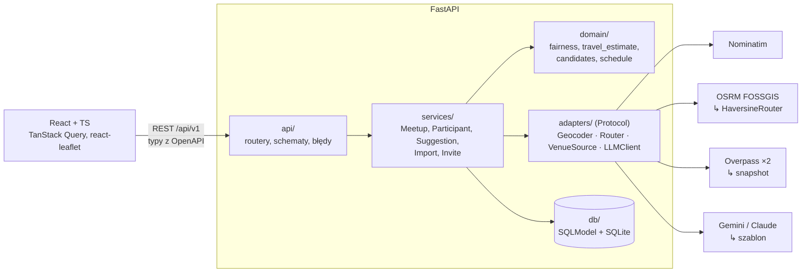

# Pół Drogi

**Sprawiedliwe miejsce spotkania dla grupy, która startuje z różnych miejsc i różnymi środkami transportu.**

Typowe aplikacje transportowe odpowiadają na pytanie „jak dojechać z A do B”. Pół Drogi odwraca je: *gdzie powinno być B, skoro jedziemy z N różnych miejsc?* Tworzysz spotkanie, dodajesz znajomych (skąd jadą i czym), a aplikacja proponuje kawiarnię, bar, restaurację albo park, do których dojazd jest **sprawiedliwy** — nikt nie jedzie 50 minut, gdy inni jadą 5.


<!-- GIF nagrywany ręcznie — umieść plik w docs/demo.gif -->

Zadanie rekrutacyjne Xelerit: Full-Stack MVP o tematyce transportu.

## Co jest w środku

- **Ranking minimax** — wygrywa miejsce z najkrótszym *najdłuższym* dojazdem; remis rozstrzyga suma czasów. Przy każdej propozycji paski czasu każdej osoby i odznaka „Różnica: N min”.
- **Prawdziwe czasy** z OSRM (pieszo, rower, auto); komunikacja miejska jako uczciwie oznaczony szacunek („≈”).
- **„Wklej z czatu”** — AI zamienia wiadomość z grupowego czatu na *szkic* listy uczestników, który poprawiasz i zatwierdzasz.
- **Zaproszenie na czat** — kod liczy czasy dojazdu i godziny wyjścia, AI tylko redaguje tekst. Bez AI ta sama treść powstaje z szablonu.
- **Mapa** z uczestnikami, kandydatami i liniami dojazdu po najechaniu na propozycję.
- **Działa bez kluczy AI** — każda zewnętrzna usługa ma fallback (lokale offline po jednorazowym zbudowaniu snapshotu — patrz niżej).

## Szybki start

### Docker (jedna komenda)

```bash
docker compose up --build
```

- Frontend: <http://localhost:5173>
- API + Swagger: <http://localhost:8000/docs>

Plik `.env` jest opcjonalny — bez niego aplikacja działa w trybie bez AI, a w bazie czeka przykładowe spotkanie „Kawa w sobotę”.

### Ręcznie

```bash
# backend (Python ≥ 3.12)
cd backend
python -m venv .venv && source .venv/bin/activate   # Windows: .venv\Scripts\activate
pip install -r requirements-dev.txt
uvicorn app.main:app --reload

# frontend (Node ≥ 20), w drugim terminalu
cd frontend
npm install
npm run dev
```

### Funkcje AI (opcjonalnie, za darmo)

1. Wygeneruj klucz w [Google AI Studio](https://aistudio.google.com/apikey) (bez karty płatniczej).
2. `cp .env.example .env` i wpisz `GEMINI_API_KEY=...`.
3. Uruchom ponownie backend. `GET /api/v1/meta` pokaże `"ai_enabled": true`, a w UI pojawi się „Wklej z czatu”.

Domyślny model: `gemini-3.5-flash-lite` (darmowy próg). Inny model: `LLM_MODEL=...`. Claude: `LLM_PROVIDER=claude` + `ANTHROPIC_API_KEY` (płatne, kredyty przedpłacone).

> Na darmowym progu Gemini dane mogą być używane przez Google do ulepszania usług — w demie wpisuj tylko przykładowe adresy.

### Snapshot lokali (zalecane, raz)

Gdy Overpass API jest niedostępne, ranking korzysta z zapisanej listy lokali Trójmiasta. Repozytorium zawiera pusty plik (środowisko, w którym powstał kod, nie miało dostępu do Overpass — lokali nie wymyślaliśmy). Zbuduj go jednym poleceniem:

```bash
cd backend && python scripts/build_venue_snapshot.py
```

Skrypt pobiera do ~40 nazwanych obiektów na kategorię i zapisuje `backend/data/venues_trojmiasto.json` (© OpenStreetMap contributors, ODbL).

## Konfiguracja (`.env`)

| Zmienna | Domyślnie | Opis |
|---|---|---|
| `LLM_PROVIDER` | `gemini` | `gemini` \| `claude` \| `none`; brak klucza ⇒ `none` |
| `GEMINI_API_KEY` | — | darmowy klucz z Google AI Studio |
| `ANTHROPIC_API_KEY` | — | opcjonalny, płatny |
| `LLM_MODEL` | puste | nadpisuje model dostawcy |
| `OSM_USER_AGENT` | `pol-drogi/1.0 (contact@example.com)` | wymagany przez politykę Nominatim — wpisz swój e-mail |
| `CORS_ORIGINS` | `http://localhost:5173` | lista po przecinku, nigdy `*` |
| `DATABASE_URL` | `sqlite:///./data/app.db` | SQLite; baza i seed tworzą się przy starcie |

## Architektura



- `domain/` — czyste funkcje bez I/O (najwięcej testów).
- `adapters/` — każda usługa zewnętrzna za interfejsem `Protocol`; wszystkie wstrzykiwane przez `Container`, w testach podmieniane na atrapy (zero sieci w testach).
- Endpointy synchroniczne — patrz ADR-004.
- Frontend: `src/api/schema.d.ts` generowany z `/openapi.json` (`npm run gen:api`) — zmiana schematu backendu daje błąd kompilacji frontendu.

### Algorytm rekomendacji

1. Prostokąt obejmujący uczestników, poszerzony o `max(1 km, 15% rozpiętości)` (nie okrąg wokół środka ciężkości — w Trójmieście środek grupy Gdynia–Gdańsk wypada w zatoce).
2. Kandydaci z Overpass (max 300 nazwanych obiektów; fallback: snapshot).
3. Prefiltr: szacunek w linii prostej, zostaje 25 kandydatów z najniższym szacowanym maksimum.
4. OSRM `table` — jedno zapytanie na każdy *użyty* profil (`routed-foot/bike/car`); awaria lub brak trasy ⇒ szacunek dla tych par.
5. Komunikacja: `5 min dojścia + 5 min czekania + (linia prosta × 1,4) / 22 km/h`, nigdy dłużej niż pieszo.
6. Minimax → suma → nazwa. Wynik w cache na 10 min (klucz: skład grupy + kategoria + limit); wyniki zdegradowane nie trafiają do cache.

## AI: „tworzy szkic, liczy kod”

| Zasada | Jak egzekwowana |
|---|---|
| Żadna liczba w UI nie pochodzi z modelu | czasy, godziny wyjścia i ranking liczy kod; tekst zaproszenia od AI jest akceptowany tylko, gdy zawiera miejsce, każdą osobę i jej godzinę wyjścia i nie podaje innych godzin — inaczej szablon |
| AI nigdy nie zapisuje do bazy | `/ai/parse-participants` i `/invite` zwracają szkic; zapis tylko przez zwykłe endpointy po akcji użytkownika |
| Wynik zgodny ze schematem | wymuszone wywołanie jednego narzędzia + walidacja Pydantic; niezgodność ⇒ `502 ai_bad_output` |
| Prompt injection | tekst użytkownika = dane; model nie ma narzędzi ze skutkami ubocznymi; limit długości wejścia |

**Prompt importu** (`backend/app/services/imports.py`) — słownik środków transportu („SKM”, „PKM”, „tramwaj” → komunikacja; „Mevo” → rower; „z buta” → pieszo…), `null` gdy środek transportu nie pada (bez zgadywania), zakaz wymyślania osób i miejsc, autor w pierwszej osobie → „Ja”. Więcej niż 10 osób ⇒ szkic obcięty z ostrzeżeniem; nieznany adres ⇒ wiersz do poprawy.

**Prompt zaproszenia** (`backend/app/services/invites.py`) — dostaje gotowe fakty (miejsce, termin w czasie polskim, czas dojazdu i godzina wyjścia każdej osoby = termin − dojazd − 5 min, w dół do 5 min); ma je tylko zredagować w ≤ 600 znakach.

## Degradacja

| Awaria | Zachowanie |
|---|---|
| Brak klucza AI | `/meta` → `ai_enabled: false`; UI ukrywa „Wklej z czatu”; zaproszenie z szablonu |
| AI zwraca błędne dane | `502 ai_bad_output`, toast „AI nie poradziło sobie z tym tekstem — dodaj osoby ręcznie” |
| Limit darmowego progu AI (429) | `503 ai_unavailable` z czytelnym komunikatem; zaproszenie z szablonu |
| Nominatim nie znajduje adresu | `422 address_not_found`; w szkicu AI wiersz oznaczony do poprawy |
| Nominatim niedostępny | `503 geocoding_unavailable` |
| OSRM niedostępny | `HaversineRouter`, `data_source: "estimate"`, etykieta „≈ szacunek” |
| Overpass niedostępny (oba endpointy) | snapshot, `venue_source: "snapshot"`, notka w UI; pusty snapshot ⇒ komunikat o awarii + „Spróbuj ponownie” |
| Usługa wolno odpowiada | timeout 8 s bez ponowień; po pierwszej awarii OSRM pozostałe profile od razu szacunkiem; AI: timeout 20 s ⇒ szablon |

## API

Pełna dokumentacja: <http://localhost:8000/docs>. Prefiks `/api/v1`; każdy błąd ma format:

```json
{ "error": { "code": "meetup_not_found", "message": "Spotkanie o id 7 nie istnieje.", "details": null } }
```

`404` brak zasobu · `409` reguła biznesowa (np. limit 10 uczestników) · `422` walidacja / `address_not_found` / < 2 uczestników · `502 ai_bad_output` · `503` niedostępna usługa.

## Testy i jakość

```bash
cd backend
pytest                 # domena, adaptery (httpx.MockTransport), serwisy na atrapach, API (TestClient + SQLite w pamięci)
pytest -m llm          # ewaluacja promptu importu na prawdziwym modelu (8 przypadków; pomijana bez klucza)
ruff check . && ruff format --check .

cd frontend
npm test -- --run      # Vitest + Testing Library
npm run lint           # ESLint + Prettier
npx tsc --noEmit
```

## Znane ograniczenia

- Czasy komunikacji miejskiej to szacunek, nie rozkład jazdy.
- Publiczne usługi OSM mają limity — aplikacja nadaje się do demo, nie do ruchu produkcyjnego.
- Brak godzin otwarcia lokali i rezerwacji; brak adresu lokalu w zaproszeniu (tylko nazwa).
- Snapshot lokali pokrywa tylko Trójmiasto (i trzeba go raz zbudować — patrz wyżej).
- Brak kont i współdzielenia w czasie rzeczywistym (świadomie poza zakresem).
- Schemat OpenAPI opisuje `422` domyślnym modelem FastAPI, choć API zwraca jednolity format błędów powyżej.

## Co dalej

- Prawdziwe rozkłady jazdy (GTFS ZTM Gdańsk / ZKM Gdynia / SKM) zamiast szacunku komunikacji.
- Link do spotkania dla znajomych i głosowanie nad propozycjami.
- Godziny otwarcia z OSM (`opening_hours`) — odrzucanie lokali zamkniętych w terminie spotkania.
- Własny OSRM/Nominatim w Dockerze dla przewidywalnych limitów.
- CI (GitHub Actions) z testami backendu i frontendu.

## Decyzje (ADR)

- [ADR-001: publiczne usługi OSM z łańcuchem fallbacków](docs/adr/0001-geo-data-sources.md)
- [ADR-002: Gemini domyślnie, Claude opcjonalnie, za interfejsem `LLMClient`](docs/adr/0002-ai-provider.md)
- [ADR-003: metryka sprawiedliwości — minimax](docs/adr/0003-fairness-metric.md)
- [ADR-004: endpointy synchroniczne](docs/adr/0004-sync-endpoints.md)

Specyfikacja i plan implementacji: `docs/superpowers/`.

## Narzędzia AI użyte przy tworzeniu

Specyfikację, plan i kod przygotowałem z pomocą **Claude (Anthropic) w Claude Code**, w procesie: burza mózgów → specyfikacja → plan zadanie po zadaniu → implementacja metodą TDD (test przed kodem, commit po każdym zadaniu) → niezależny przegląd całości. Decyzje projektowe, akceptację specyfikacji i planu oraz testy klikane w interfejsie wykonałem sam.

## Atrybucja

Dane mapowe i lokale © [OpenStreetMap contributors](https://www.openstreetmap.org/copyright), licencja ODbL. Geokodowanie: Nominatim. Trasy: OSRM (serwer FOSSGIS `routing.openstreetmap.de`). Lokale: Overpass API.
